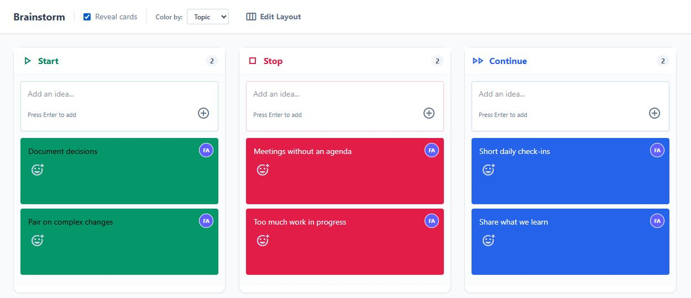
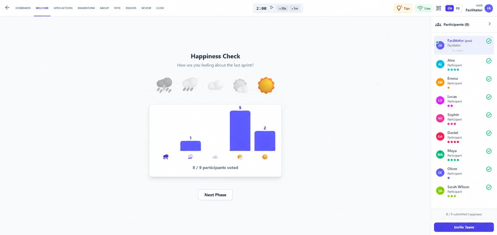
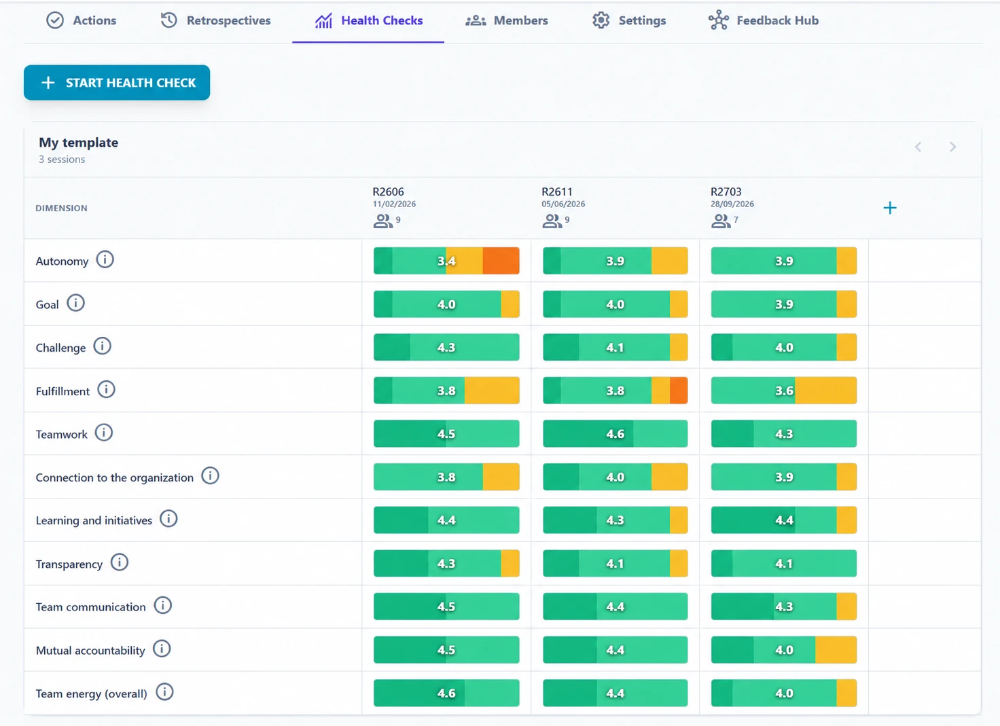

# RetroGemini

[](https://github.com/republique-et-canton-de-geneve/RetroGemini/actions/workflows/ci.yml)
[](https://hub.docker.com/r/jpfroud/retrogemini)
[](LICENSE)

[](https://render.com/deploy?repo=https://github.com/republique-et-canton-de-geneve/RetroGemini)

**Private-by-design, real-time Scrum retrospectives and team health checks for organizations that need to keep their data on their own infrastructure.**

RetroGemini was created at the **State of Geneva** and is already used by around **30 internal teams**. Because candid retrospective feedback can be sensitive, our public administration cannot send it to external cloud services. RetroGemini keeps the complete application and its data under the organization's control.

This makes it a strong fit for public-sector, healthcare, finance, regulated, privacy-conscious, and air-gapped environments — or simply for teams that prefer to own their tools and data.

> No external service is required at runtime. SMTP and OpenAI-compatible AI features are optional and disabled unless you configure them.

If RetroGemini solves a problem for your organization, please [star the repository](https://github.com/republique-et-canton-de-geneve/RetroGemini) so more self-hosting and Agile teams can find it.



*Demo board with fictional data.*



*Welcome phase of a retrospective: the happiness check, the phase bar and shared timer, and the live participants panel.*



*Health Checks tab of the dashboard: the score of each dimension, session after session.*

## Try it in 60 seconds

You only need Docker:

```bash
docker run --pull=always -d \
  --name retrogemini \
  -p 8080:8080 \
  -v retro-data:/data \
  jpfroud/retrogemini:latest
```

Open [http://localhost:8080](http://localhost:8080), create a team, and start a retrospective.

The named Docker volume keeps your test data across container restarts. For a production deployment, also set a stable `SESSION_TOKEN_SECRET`, use HTTPS through your reverse proxy, and review the configuration below.

### One-click temporary demo

The **Deploy to Render** button above creates a free personal evaluation instance from the latest published Docker image.

Render's free web services sleep after 15 minutes without traffic and use an ephemeral filesystem. The demo's SQLite data is therefore cleared whenever the service sleeps, restarts, or redeploys. Use this path to explore the product, not for a real team deployment.

## What teams get

| Area | Capabilities |
| --- | --- |
| Retrospectives | Start/Stop/Continue, 4Ls, Mad/Sad/Glad, Sailboat, KALM, DAKI, Starfish, Rose/Thorn/Bud, Hot Air Balloon, Speed Car, Lean Coffee, Three Little Pigs, and custom templates — each available in English or French, chosen per retrospective |
| Languages | English and French interface for facilitators, guests and the administration console, detected from the browser and switchable at any time; "What's New" reads in your language and invitation emails follow the sender's language |
| Guided facilitation | Icebreaker, Brainstorm, Group, Vote, Discuss, Review, and Close phases, with contextual tips and timeboxes, and the same shared countdown timer in retrospectives and health checks |
| Live collaboration | Real-time WebSocket sync, participant presence, typing activity, anonymous brainstorming, comments, grouping, and voting |
| Continuous improvement | Action proposals, assignees, carry-over between sessions, ROTI follow-up, reports, and team health trends |
| Team administration | Password-protected workspaces with a mandatory recovery email, member management, invitations, favorites, search, feedback hub, backup, and restore (the whole store or a single team, also from a backup file) |
| Optional AI | OpenAI-compatible ticket grouping, retrospective summaries, and cross-retrospective release analysis |
| Optional Jira | Create the actions of a retrospective or health check as Jira issues in one click, from the Review step or the Dashboard, on Jira Data Center or Jira Cloud, each action then linked to its issue |
| Enterprise deployment | SQLite or PostgreSQL, multi-pod Socket.IO adapters, Redis support, rolling-update recovery, proxies, custom CAs, Kubernetes, and OpenShift |
| Privacy | Self-hosted assets, no CDN dependency, offline and air-gapped operation, non-root container, and organization-controlled storage |

## Why RetroGemini

- **Your retrospective data stays with you.** The core application makes no external service calls and can run on an isolated network.
- **It is designed for real facilitation.** Sessions follow a clear workflow rather than presenting an unstructured sticky-note board.
- **It supports the work after the retro.** Actions, decisions, health checks, reports, and follow-up remain visible over time.
- **It starts small and scales.** Use one Docker container with SQLite, or PostgreSQL plus Redis/PostgreSQL adapters for multiple pods.
- **It has real organizational usage.** The product is shaped by feedback from approximately 30 teams at the State of Geneva.
- **It is open source with a permissive public-domain license.** Use, adapt, and redistribute it without vendor lock-in.

## Docker Compose

```bash
git clone https://github.com/republique-et-canton-de-geneve/RetroGemini.git
cd RetroGemini
docker compose up -d app
```

The application is available at [http://localhost:8080](http://localhost:8080), with data persisted in the `retro-data` volume.

## Production example

Generate and keep a stable secret in your secret manager, then run:

```bash
docker run --pull=always -d \
  --name retrogemini \
  --restart unless-stopped \
  -p 8080:8080 \
  -v /path/to/retrogemini-data:/data \
  -e SESSION_TOKEN_SECRET='replace-with-a-long-random-secret' \
  -e SUPER_ADMIN_PASSWORD='replace-with-a-strong-admin-password' \
  jpfroud/retrogemini:latest
```

Put RetroGemini behind an HTTPS reverse proxy before exposing it outside a trusted network.

## Deployment options

### Docker

Build the image yourself if you do not want to pull the published image:

```bash
docker build -t retrogemini .
docker run -d \
  --name retrogemini \
  -p 8080:8080 \
  -v /path/to/data:/data \
  retrogemini
```

### Kubernetes / OpenShift

See [the Kubernetes and OpenShift guide](k8s/README.md). The container runs as a non-root user and exposes `/health` and `/ready` probes.

### Railway

1. Fork this repository.
2. Create a Railway project from your fork.
3. Add a persistent volume mounted at `/data`.
4. Deploy using the included `Dockerfile` and `railway.toml`.

Without a persistent volume, SQLite data is ephemeral and will be lost during redeployments.

## Configuration

All configuration is provided through environment variables. See [`.env.example`](.env.example) for the complete list.

| Variable | Description | Default |
| --- | --- | --- |
| `PORT` | Server port | `3000` (`8080` in Docker) |
| `DATABASE_URL` | PostgreSQL connection URL; PostgreSQL is used instead of SQLite when set | SQLite |
| `POSTGRES_HOST` | PostgreSQL host — the discrete alternative to `DATABASE_URL`, used when it is unset (what the Kubernetes manifests supply from the PostgreSQL Secret) | None |
| `POSTGRES_PORT` | PostgreSQL port | `5432` |
| `POSTGRES_USER` | PostgreSQL user | None |
| `POSTGRES_PASSWORD` | PostgreSQL password | None |
| `POSTGRES_DB` | PostgreSQL database name | None |
| `DATA_STORE_PATH` | SQLite database path | `/data/data.sqlite` |
| `REDIS_URL` | Redis connection for the multi-pod Socket.IO adapter | Disabled |
| `REDIS_HOST` / `REDIS_PORT` / `REDIS_PASSWORD` | Redis connection as discrete values, when `REDIS_URL` is not used | Disabled |
| `SMTP_HOST` | SMTP server for invitations and notifications | Disabled |
| `SMTP_PORT` | SMTP server port | `587` |
| `SMTP_SECURE` | Use TLS for SMTP | `false` |
| `SMTP_USER` | SMTP username | None |
| `SMTP_PASS` | SMTP password | None |
| `FROM_EMAIL` | Sender email address | `SMTP_USER` |
| `SUPER_ADMIN_PASSWORD` | Enable the super-admin panel | Disabled |
| `SESSION_TOKEN_SECRET` | Stable HMAC secret for sessions, invitation credentials and the WebSocket join handshake; use the same value on every pod (without it, a restart drops live participants out of their session); required to save a team's Jira token (encrypted with a key derived from it), and rotating it makes every team enter its token again | Random per process |
| `BACKUP_ENABLED` | Enable automatic server-side backups | `true` |
| `BACKUP_INTERVAL_HOURS` | Hours between automatic backups | `24` |
| `BACKUP_MAX_COUNT` | Maximum automatic backups to keep | `7` |
| `BACKUP_ON_STARTUP` | Create a backup when the server starts | `true` |
| `RESTORE_MAX_BODY_MB` | Maximum compressed restore or import upload size (the uploaded restore and the Backups tab's file import) | `128` |
| `RESTORE_MAX_DECOMPRESSED_MB` | Maximum decompressed restore or import size | `512` |
| `AUTH_RATE_LIMIT_MAX` | **Rejected** team-create / restore-session credentials per IP per 15 minutes. Only `401` responses count, so a legitimate user is never blocked however often they reload, and a session a password change revoked is not counted either. Counted **per pod** (no shared store, so a multi-pod deployment allows up to `replicas ×` this value) | `5` |
| `PUBLIC_BASE_URL` | Canonical public URL used to build mailed links. **Required to send password-reset email** — that mail carries a live token and its caller is anonymous, so without a configured origin the route answers `501 public_base_url_not_configured` rather than trusting the request's `Host`. Invitations are authenticated and fall back to the request origin when it is unset. May include a sub-path | None (invitations fall back to the request origin) |
| `CORS_ORIGIN` | Restrict Socket.IO CORS to specific origin(s) | `*` |
| `TRUST_PROXY` | Express trust-proxy setting | `1` in production |
| `LOG_FORMAT` | `json` writes one line of JSON per log record — timestamp, level, source, message and the request/socket correlation id — which a cluster log aggregator can query; `text` keeps the human-readable console output. Secrets are redacted in both | `json` in production, `text` otherwise |
| `WIFI_SSID` | Wi-Fi name for an optional offline-network QR code | Disabled |
| `WIFI_PASSWORD` | Wi-Fi password for the optional QR code | Disabled |
| `PG_POOL_MAX` | PostgreSQL connections **per pod**; keep `replicas × PG_POOL_MAX` under the database's `max_connections` | `10` |
| `SESSION_CACHE_MAX` | Live sessions cached in memory per pod (bounds memory only — session state is always recoverable from the database) | `500` |
| `SESSION_CACHE_MAX_MB` | Total size, in MB of session JSON, of the per-pod session cache, beside `SESSION_CACHE_MAX`'s count (bounds memory only; the session just written is never evicted) | `32` |
| `SOCKET_MAX_BUFFER_SIZE` | Maximum Socket.IO message size in bytes (caps one session update) | `1000000` |
| `SOCKET_UPDATE_RATE` | Sustained session updates per second allowed per socket. Off by default and off in the shipped manifest — enable it only if the deployment is reachable beyond your internal network, or if a runaway client is actually observed. Start at `20` (timer sync is ~1/s per client). A throttled write is healed with the authoritative state and re-sent, never dropped | `0` (disabled) |
| `SOCKET_UPDATE_BURST` | Short update burst allowed above the sustained rate | `2 × rate` |
| `LAST_CONNECTION_DEBOUNCE_MS` | Minimum interval between refreshes of a team's last-connection date on join (avoids a write storm when a whole session reconnects) | `300000` |
| `ROSTER_BROADCAST_DEBOUNCE_MS` | Debounce window for coalescing roster rebroadcasts (avoids an O(N²) reconnect stampede); `0` broadcasts synchronously | `250` |

### Data persistence

RetroGemini supports two database backends:

- **SQLite** for a simple single-container or single-pod deployment.
- **PostgreSQL** for production and multi-pod deployments.

For SQLite, the server tries these locations in order:

1. `DATA_STORE_PATH`
2. `/data/data.sqlite`
3. `/tmp/data.sqlite` — ephemeral
4. `./data.sqlite`

A warning is logged when ephemeral storage is used.

For multiple pods, Socket.IO uses Redis when `REDIS_URL` or `REDIS_HOST` is configured. Otherwise it uses the PostgreSQL adapter when PostgreSQL is the data store.

### Corporate proxy and custom CA

The server makes outbound HTTP calls for two optional features only: the AI
endpoint and [Jira](#jira). **Node.js does not read `HTTP_PROXY` or
`HTTPS_PROXY` on its own**, so setting them alone changes nothing. Set
`NODE_USE_ENV_PROXY=1` as well — Node.js's own switch (Node 22.21 / 24.5 and
later; the image runs Node 26), not a RetroGemini setting — and list in
`NO_PROXY` every host the server must reach directly: an internal Jira or LLM
endpoint above all, which a corporate proxy usually cannot reach.

```bash
export NODE_USE_ENV_PROXY=1
export HTTPS_PROXY=http://proxy.example.com:8080
export HTTP_PROXY=http://proxy.example.com:8080
export NO_PROXY=localhost,127.0.0.1,jira.internal.example
export NODE_EXTRA_CA_CERTS=/path/to/corporate-ca.crt
```

`NODE_EXTRA_CA_CERTS` adds your organization's CA, for an internal Jira or LLM
endpoint or a TLS-inspecting proxy; prefer it to the "allow self-signed
certificates" switches of the AI and Jira settings, which turn certificate
checking off. SMTP does not go through the HTTP proxy. The same variables can be
configured in Docker Compose, Kubernetes, or OpenShift.

### Jira

Teams can create their actions as Jira issues. In the Review step of a
retrospective or health check, one click sends the session's new actions not yet
in Jira, and the previous actions a retrospective shows are sent one at a time;
in the Dashboard's Actions tab, one click sends every open action listed there,
or each one on its own. Each action then shows its issue key as a link. Jira
Data Center / Server and Jira Cloud are served by the same code. It stays off
until it is set up in two places:

1. **The super administrator connects the deployment's one Jira** in the
   administration console's *Jira* card: turn it on, enter the **Jira base
   URL** (`https://jira.example.org`, or with its context path,
   `https://intranet.example.org/jira`), press **Test** — an anonymous call that
   shows Jira's version and whether it is Cloud, saving nothing — then save.
   Changing the address later makes every team enter its token again: a token
   is bound to the address it was checked against and is never sent anywhere
   else.
2. **Each team saves one Jira token** in the Dashboard's *Settings → Jira*, and
   chooses where its issues go: a project and an issue type, the sub-tasks of
   one parent issue, or the sub-tasks of a parent issue RetroGemini creates for
   each retrospective or health check (and one for the Dashboard's actions),
   plus labels (`retrospective` by default). In both sub-task modes, another
   parent issue can be named when the actions are sent.
   - **Data Center / Server:** a personal access token (Jira 8.14 or later),
     with the email left empty.
   - **Cloud:** the account's email and a **classic API token**, not an API
     token "with scopes", which works only through Atlassian's API gateway and
     not against your site's address. Cloud API tokens expire within a year:
     plan to replace it.
   - **Use a technical account.** The token belongs to the team: anyone signed
     in to the team, through an invitation link included, can create issues
     with it through RetroGemini, change where they go, and look up which
     projects and issue keys its account can see. Each issue carries the name
     the requester's browser sent, which RetroGemini cannot verify. Give that
     account access to the team's projects only.

The token is write-only: checked against Jira when it is saved, encrypted at rest
with a key derived from `SESSION_TOKEN_SECRET`, never sent back to a browser, and
not in backup archives (see [SECURITY.md](SECURITY.md)). Saving one therefore
**requires a stable `SESSION_TOKEN_SECRET`** other than the templates' example
value, kept in a secret store and never next to the database dumps (the two
together open every team's token), and rotating that secret makes every team
enter its token again — a newly issued one when the rotation follows a leak.
After restoring an application archive into a new database, re-enter the Jira
settings in the console, and every team its token
([k8s/README.md](k8s/README.md#jira)). **After any restore to an older state**,
an action sent to Jira after the backup can show as not in Jira: check the
team's Jira project before pressing "Create in Jira (N)".

**The server talks to Jira, never the browser** — the Content-Security-Policy
forbids the browser from doing so, and Jira Data Center sends no CORS headers.
The application pods therefore need **egress to Jira**, the proxy settings above
when Jira is reached through a proxy (with an internal Jira in `NO_PROXY`), and
`NODE_EXTRA_CA_CERTS` when Jira's certificate comes from an internal CA. No new
environment variable is involved.

What an issue holds: the action's text as its summary (one line, at most 255
characters), and a description naming the retrospective or health check, its
date, the ticket or group the action came from (quoted, in anonymous sessions
too) and who asked, written in the session's template language; the labels come
from the team's target. In the mode with a parent issue per session, each
parent issue carries the session's name and date (the team's name for the
Dashboard's parent) and who asked, in the same language. Required custom fields are not supported: Jira's own
message is shown instead. An action already linked to an issue is never sent
again, and two clicks at once create one issue. When Jira's answer is lost, the
action says it may already be in Jira and asks the facilitator to check before
creating it anyway — which creates a second issue if the first one exists. The
other cases where an action can reach Jira twice (a merged team whose source
teams are not deleted yet, a rolling update from a release before Jira, a
restore to an older state) are listed with the residuals in
[SECURITY.md](SECURITY.md#jira-tokens). Nothing
comes back from Jira: closing the issue does not close the action.

## Architecture

- **Frontend:** React 19, TypeScript, Vite, Tailwind CSS
- **Backend:** Express 5, Socket.IO 4
- **Storage:** SQLite with WAL mode or PostgreSQL
- **Scale-out:** Redis or PostgreSQL Socket.IO adapter
- **Container:** Node 26 Alpine, non-root user
- **Delivery:** JSON answers over 1 KiB are gzipped, the hashed bundle is precompressed at build time and cached for a year, and `index.html` is revalidated on every load, with no proxy configuration needed

The application is designed to survive rolling updates: session state is persisted, WebSocket clients reconnect automatically, and participants rejoin their active session.

## Quality and security

Every pull request runs linting, TypeScript checks, unit and integration tests, a production build, dependency review, CodeQL analysis, and container vulnerability scanning.

Useful local checks:

```bash
npm run lint
npm run type-check
npm test
npm run build
npm run test:e2e
```

See [MAINTENANCE.md](MAINTENANCE.md), [HARDENING_STATUS.md](HARDENING_STATUS.md), [SECURITY.md](SECURITY.md), and [ACCESSIBILITY.md](ACCESSIBILITY.md) for details.

Accessibility is gated on every pull request — an axe-core run over fifteen screens and `eslint-plugin-jsx-a11y` inside the lint budget. Both are ratchets: the number they allow may fall, never rise. [ACCESSIBILITY.md](ACCESSIBILITY.md) states what is tested, what was fixed, and what is still missing.

## Development

Requirements: Node.js 22+ and npm.

```bash
npm install
npm run start
```

In another terminal:

```bash
npm run dev
```

The backend runs on port 3000 and the Vite development server on port 5173.

## Built with AI assistance, not dependent on AI

RetroGemini was developed with extensive assistance from Gemini, Claude, and Codex. That describes the development process, not a runtime dependency: the application works without an internet connection or an AI service.

Administrators can optionally connect an OpenAI-compatible model for grouping suggestions and summaries. Those features remain off until explicitly configured.

## Contributing

Bug reports, feature requests, documentation improvements, translations, and code contributions are welcome. Read [CONTRIBUTING.md](CONTRIBUTING.md) before opening a pull request.

If you deploy RetroGemini, consider opening a discussion or issue to share your environment and feedback. Real-world deployment notes help other organizations adopt it.

## License

RetroGemini is released into the public domain under [The Unlicense](LICENSE). You may use, copy, modify, and distribute it for any purpose without conditions.
